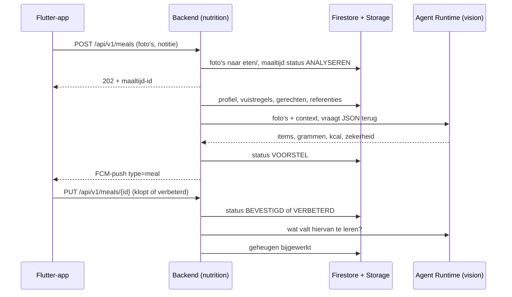

# Eetdagboek met foto's — ontwerp

Status (18 november 2026): **alle zes stappen zijn gebouwd, op de onderdelen hieronder na.**

Aanvulling 20 november 2026: de referentiefoto's komen uit een **referentiebibliotheek** (elke unieke combinatie van gerecht, servies en hoeveelheid één keer; dubbelen worden gemarkeerd en niet opnieuw gebruikt) in plaats van drie gewogen maaltijden op kloktijd, en bij een eetmoment is vast te leggen welk **deel is opgegeten**: de portie blijft heel voor de referenties, de dag telt minder.

Gebouwd:

- Stap 1: backendmodule `nutrition`, scherm Eten onder Meer (`lib/food_screen.dart`).
- Stap 2: backendmodule `wellbeing`, check-in-scherm, de vraag onder het vastleggen, drie
  meldingen per dag.
- Stap 3: backendmodule `activity`, uitlezen van Health Connect (`lib/health_sync*.dart`),
  verbruik/stappen/trainingen/slaap op het scherm Eten.
- Stap 4: gewogen maaltijden gaan als referentiefoto mee met een nieuwe analyse, samen met de
  eerder gewogen porties; een receptlink in de notitie wordt opgehaald en meegegeven.
- Stap 5: weekscherm met gewicht invoeren (`lib/food_week_screen.dart`), regel "Eten en bewegen"
  in de briefing, chat-tools, avondherinnering om 20:45.
- Stap 6: backendmodule `insights` met zes verbanden, scherm Verbanden.

- Na stap 6 (18 november 2026): **tijdlijn en dutjes.** Het scherm Eten toont de dag op volgorde
  van tijd: nachtslaap, wandelingen en trainingen (van Garmin), eetmomenten, check-ins en dutjes.
  Een dutje start Robbert zelf, eventueel met een wekker (dezelfde native wekker als de alarms,
  met een eigen plek zodat het herplannen van alarms hem niet wist), en meldt hij af met "nu" of
  "zoveel minuten geleden"; achteraf invullen kan ook. De wekker uitzetten met Sluit sluit het
  dutje af. Meldt hij zich niet af, dan schat de backend het eind (`insights.NapEstimator`) uit
  het vroegste teken dat hij weer wakker was: de eerste minuut met stappen na het begin (de app
  haalt die uit Health Connect, van horloge of telefoon), het begin van een wandeling, een foto
  van eten, een check-in of de wekkertijd. Garmin levert stappen per minuut, alleen voor minuten
  waarin gelopen is; een schatting schuift nog naar voren als die gegevens later binnenkomen.
  Verder dan drie uur na het begin zegt een teken niets meer en wordt het de wekkertijd of een
  half uur. Dutjesherkenning van het horloge wordt niet gebruikt (de Venu 3 herkent ze zelden).
  Twee verbanden erbij: dutje tegen energie later op de dag, en korte nacht tegen een dutje.
- 19 november 2026: **het scherm heet Dagboek en is een eigen tab** (Vandaag, Assistent,
  Dagboek, Taken, Meer); "Eten" onder Meer is weg. Bovenaan staan vier acties naast elkaar: Eten
  (foto), Gevoel, Dutje en Gewicht. Gewicht is een invoerblad voor de getoonde dag en staat daarna
  bovenaan die dag (er is geen tijdstip bij bekend). De totalen zijn compacter; de richtwaarden
  voor vezels en groente staan op Deze week. De tab laadt opnieuw als hij wordt gekozen en als de
  app terugkomt.

Bewust anders of niet gebouwd:

- **Vaste gerechten, recepten en producten staan niet in eigen collecties** maar in het
  tekstgeheugen (`food-memory`), dat de leerstap na elke bevestiging bijwerkt. De collecties
  `food-dishes`, `recipes`, `food-products`, `food-references`, `food-profile` en `insights` uit
  §7 bestaan dus niet; referenties worden afgeleid uit bevestigde maaltijden met gewogen
  onderdelen. Scherm 5 is daardoor één bewerkbaar tekstveld.
- **De analyse is één AI-aanroep**, niet twee: de referentiefoto's gaan direct mee. Dat scheelt
  een halve minuut wachttijd per foto.
- **Verbanden zonder AI-weektekst en zonder proefjes.** De bevindingen zijn uitgerekende zinnen.
- **Snelkoppelingen in plaats van een widget:** ingedrukt houden op het app-icoon geeft "Foto van
  eten", "Hoe voel je je?" en "Dutje" (`lib/app_shortcuts.dart`); ze zijn los op het startscherm te zetten.
- **Garmin-sync bij het openen van de app en bij terugkeer**, hooguit één keer per kwartier, in
  plaats van een taak op de achtergrond. Elke sync haalt zeven dagen op.
- **Niet gebouwd:** antwoordknoppen ín de melding (Android toont er hooguit drie, een check-in
  heeft twee schalen), een receptlink delen vanuit de browser (plakken in het tekstvak werkt) en
  de gewichts-ijking van de schattingen.

Getest: backend- en app-tests; de schermen lokaal in de browser; en op Robberts telefoon met een
testversie naast de echte app (tegen een lokale backend met nagebootste AI): snelkoppelingen,
vastleggen met de camera, check-ins en de Garmin-sync van zeven dagen.
**Nog niet getest:** de echte AI-analyse met een foto (dus ook niet of referentiefoto's en
recepten het voorstel verbeteren), de meldingen op de telefoon, en van de dutjes alles wat alleen
op de telefoon bestaat: de wekker, de doorlopende melding en het schatten uit echte stappen.

Testen op de telefoon zonder de echte app te raken: zet tijdelijk `applicationIdSuffix = ".test"`
in het debug-buildtype, een `src/debug/google-services.json` met die pakketnaam en
`usesCleartextTraffic` in het debug-manifest; bouw met
`--dart-define=API_BASE_URL=http://127.0.0.1:8091 --dart-define=SKIP_GOOGLE_AUTH=true` en gebruik
`adb reverse tcp:8091 tcp:8091` naar een lokale backend (`RA_SECRETS_FILE` met
`RA_PREVIEW_SKIP_GOOGLE_AUTH=true` en `RA_MOCK_AI=true`). Niet committen.

## 1. Doelen en gemaakte keuzes

| Doel | Gevolg voor het ontwerp |
|---|---|
| **Fit voelen, geen honger** (hoofddoel) | Check-ins zijn de maat waar alles op gericht is. Per maaltijd: hoe lang hield die vol (tijd tot eerste "trek", per 100 kcal). |
| **Niet zwaarder worden, liefst 2 kg eraf** (geen hoofddoel) | Geen dagdoel, geen rode cijfers. Wel een weekgemiddelde gegeten tegen verbruikt. |
| **Weten wat hij binnenkrijgt** | Eiwit, vezels en groente naast calorieën op het Vandaag-scherm, met richtwaarde (ca. 30–40 g vezels, 250 g groente per dag). Fruit, koolhydraten, vet in het weekoverzicht. |
| **Meer op vetverbranding** (bijvangst) | Niet meetbaar met deze middelen. Wel ter info: nachtelijke periode zonder eten en minuten op lage intensiteit. Geen streefwaarde. |

Keuzes:

- **Plek:** in de hoofdapp `robberts_assistent/` (tegel op Vandaag, scherm Eten onder Meer,
  snelkoppeling die direct de camera opent).
- **Gewicht:** handmatig invoeren, eens per paar weken.
- **Dranken:** foto, net als eten. Water en thee hoeven niet.
- **Check-ins:** drie meldingen per dag, alleen honger en energie.

## 2. Nauwkeurigheid

Een foto-schatting zit per maaltijd naar verwachting 20–40% naast de werkelijkheid; wat je
niet ziet (olie, boter, saus) telt niet mee. Goed genoeg voor een trend over weken, niet voor
exact tellen per dag. Wat het beter maakt, in volgorde van effect:

1. **Gewogen referenties** (zie §5) — vooral voor het vaste ontbijt en de vaste lunch.
2. **Recept of etiket erbij** (zie §3) — vangt de onzichtbare ingrediënten.
3. **Herhaling** — twintig tot dertig dingen komen steeds terug.
4. **Eigen servies als maatstaf** — eenmalig borden, kommen, glazen en mokken vastleggen met
   de maat. Daarna bestek in beeld; de hand (eenmalig gekalibreerd naast een bankpas) alleen
   buiten de deur of als de app twijfelt. De hand is dus een hulpmiddel, geen verplichting.
5. **Gewicht als ijkpunt** — berekende balans tegen de weegschaal; duurt twee tot drie
   maanden bij een weging eens per paar weken en blijft grof.

Volgorde van vertrouwen per onderdeel: gewogen → etiket → recept → vergeleken met een
referentie → geschat. Bij twee bronnen wint de hoogste.

## 3. UX

### Schermen

1. **Vastleggen** — camera opent direct. Meerdere foto's mogelijk, knop Klaar start de
   analyse. Optioneel inspreken ("met een scheut olijfolie", "de helft opgegeten") of een
   receptlink toevoegen. Onder de camera: "hoe voelde je je net voor het eten?".
2. **Voorstel** — komt als push. Per onderdeel naam, hoeveelheid, kcal en of hij twijfelt.
   Knoppen Klopt en Verbeteren. Geen reactie = telt mee als "niet bevestigd".
3. **Verbeteren** — regel aantikken en portie/product kiezen, grammen invullen met
   weegschaaltje ("gewogen"), of in gewone woorden zeggen wat niet klopt. Onderaan staat
   letterlijk wat hij ervan onthoudt.
4. **Vandaag** — gegeten naast verbruikt (rust + bewegen, stappen, trainingen), eiwit,
   vezels, groente, en de eetmomenten als tijdlijn. Compacte versie als Vandaag-tegel.
5. **Wat ik van je weet** — vaste gerechten (met aantal keer gegeten en gewogen),
   vuistregels, servies. Alles leesbaar, wijzigbaar, verwijderbaar.
6. **Check-in** — honger (geen · trek · beetje honger · honger · slap) en energie (1 moe – 5 fit). Twee
   tikken. De app zet er zelf context bij (tijd sinds laatste maaltijd, slaap, training).
7. **Verbanden** — elke bevinding met de getallen erachter en het aantal dagen waarop ze
   steunt; wat te dun is staat als zodanig gemarkeerd.

### Meerdere foto's per eetmoment

Een eetmoment is een mapje. De AI bepaalt zelf wat een foto is.

| Toevoeging | Levert op |
|---|---|
| Bord (en een tweede bij opscheppen) | Wat en hoeveel. Tweede bord telt erbij op. |
| Recept: foto of link | Alle ingrediënten voor het hele gerecht; het bord bepaalt welk deel gegeten is. |
| Verpakking of etiket | Waarden per 100 g en verpakkingsgewicht, afgelezen. |
| Ingrediënten op het aanrecht | Producten, merken en ongeveer hoeveel. |
| Weegschaal met display | Gemeten gewicht, en daarmee een referentie. |

Binnen een uur na een maaltijd een nieuwe foto → "Hoort dit bij je avondeten?" met Ja als
standaard. Na elke toevoeging wordt het hele eetmoment opnieuw doorgerekend. Recepten en
gelezen etiketten worden bewaard en hergebruikt.

### Check-ins

Vier ingangen: bij elke etensfoto, een widget op het startscherm, drie meldingen per dag met
actieknoppen (rond 10:30, 15:30, 20:30, instelbaar), en via chat/praatmodus.

De vaste meldingen zijn nodig: wie alleen logt bij een opvallend gevoel, heeft alleen
uitschieters en geen gewone momenten om mee te vergelijken.

### Overig

- Zonder foto kan ook: "ik heb net een appel en een koffie gehad" in de chat.
- Herkent hij een vast gerecht, dan is het voorstel één regel met één knop.
- Eén avondmelding als er om 20:30 nog geen avondeten staat (instelbaar).
- Weekscherm: gemiddelden, gewichtslijn, aandeel gewogen/vergeleken/geschat, aandeel
  bevestigd. Korte tekst in de zondag-briefing.

## 4. Garmin

| Route | Wat het levert | Oordeel |
|---|---|---|
| **Health Connect** (Garmin Connect-app → Health Connect → onze app) | Stappen, afstand, actieve en totale calorieën, trainingen, hartslag, slaap | **Aanrader.** Officieel, gratis, geen inloggegevens. Alleen Android/APK. |
| **Strava** (bestaat al) | Trainingen met calorieën | Aanvulling en terugval. |
| Onofficiële Garmin Connect-API | Alles | Afrader: sinds maart 2026 kapotte logins en geblokkeerde accounts. |
| Officiële Garmin Health API | Alles | Alleen voor bedrijven. |

De app leest de laatste zeven dagen uit Health Connect en stuurt ze naar de backend: bij het
openen, bij elke etensfoto en een paar keer per dag op de achtergrond.

**Gecontroleerd via adb op 17 november 2026** (Pixel 10 Pro, Android 17, Health Connect
ingebouwd, Garmin Connect 5.31): de koppeling staat aan. Garmin Connect heeft door Robbert
toegekende schrijfrechten voor stappen, afstand, snelheid, verdiepingen, hoogtewinst,
actieve calorieën, totale calorieën, trainingen, hartslag, rusthartslag, slaap, gewicht en
vetpercentage. Geen rechten voor HRV, stress of Body Battery; die komen dus niet mee.

**Inhoud gecontroleerd op 17 november 2026** met een losse test-app (Flutter-pakket
`health` 13.3.2, alleen leesrechten, laatste zeven dagen). Het werkt; de gegevens waren
minder dan een uur oud. Bevindingen en wat ze voor de bouw betekenen:

| Gegeven | Wat er staat | Gevolg |
|---|---|---|
| Totale calorieën | Alleen van Garmin. Elke dag compleet, van 00:00 tot 23:59, opgeknipt rond trainingen. | **Dit is de bron voor "verbruikt".** Geen eigen berekening van rustverbruik nodig. |
| Actieve calorieën | Van Garmin alleen rond trainingen en niet elke dag; daarnaast een eigen schatting van de telefoon. | Niet gebruiken als dagtotaal. |
| Stappen, afstand | **Twee bronnen:** Garmin én de stappenteller van de telefoon zelf. Optellen geeft ongeveer het dubbele. | Altijd filteren op bron `com.garmin.android.apps.connectmobile`. |
| Slaap | Elke nacht een sessie met begin en eind, plus fases licht, diep, REM en wakker. | Bruikbaar zoals ontworpen. |
| Trainingen | Soort, begin, eind en calorieën. Afstand ontbreekt soms (binnen fietsen). | Bruikbaar; afstand optioneel. |
| Rusthartslag | Eén waarde per dag. | Bruikbaar als extra kenmerk voor de verbanden. |
| Hartslag | Ongeveer elke anderhalve minuut. | Alleen ophalen als er iets mee gedaan wordt (minuten lage intensiteit). |
| Gewicht, vetpercentage | Niets. | Handmatig invoerveld, zoals gekozen. |

Aandachtspunten voor de bouw:

- De stappen-uitlezing gaf precies 2000 records terug; dat lijkt een limiet per aanvraag.
  Lees per dag, of gebruik de aggregatie van Health Connect.
- Het laatste calorieën-blok van vandaag loopt al tot 23:59. Vermoedelijk rekent Garmin
  het rustverbruik voor de rest van de dag vooruit; nog niet bevestigd. Toon de lopende dag
  daarom als voorlopig.
- `MainActivity` moet `FlutterFragmentActivity` zijn en `minSdk` 26. De eerder geplande proefstap is hiermee gedaan; bouwstap 3 kan direct met de echte
koppeling beginnen.

## 5. Hoe het leren werkt

Er wordt geen model getraind. Het leren zit in wat de AI bij elke nieuwe foto meekrijgt.

### Gewogen referenties

Een referentie is een foto waarvan de gewichten gemeten zijn.

- Robbert weegt wanneer het uitkomt: grammen invullen in het verbeterscherm, of inspreken.
- Foto van het bord op de weegschaal: de AI leest het display af.
- De app vraagt er zelden om (iets wat vijf keer gegeten en nooit gewogen is; hooguit één
  vraag per week).

Analyse in twee stappen: eerst herkennen wat er ligt, dan haalt de backend de gewogen foto's
van die producten/dat gerecht op en krijgt de AI ze ernaast met de gemeten waarden.

| Situatie | Hoe hij tot een getal komt | Label |
|---|---|---|
| Vast ontbijt/lunch, paar keer gewogen | Gemiddelde van de wegingen; foto alleen voor afwijkingen | GEWOGEN |
| Bekend product, andere hoeveelheid | Vergelijken met gewogen foto's, liefst zelfde servies | VERGELEKEN |
| Iets nieuws | Schatten op servies, bestek of hand | GESCHAT |

### Overige context per analyse

1. Profiel en servies-maten.
2. Het document met vuistregels.
3. Lijst vaste gerechten (meest gegeten bovenaan, met gebruikelijk tijdstip).
4. De laatste verbeterde maaltijden rond hetzelfde tijdstip, met voorstel én correctie.

Na elke bevestiging of correctie werkt een tweede, stil falende AI-aanroep het geheugen bij
(zelfde patroon als `memoryChatClient`).

Calorieën schat de AI in de eerste versie zelf. Later eventueel de NEVO-tabel (RIVM) als
opzoektabel voor vaste waarden per 100 g.

## 6. Verbanden vinden

Verwachting: één persoon, één dag per dag, en slaap, sport, eten en werkdruk bewegen
tegelijk. Reken op zes weken voor de eerste patronen; lees ze als aanwijzing.

1. **De backend rekent, de AI niet.** Per check-in vaste kenmerken: uren sinds laatste
   maaltijd, grootte en samenstelling daarvan, slaapduur afgelopen nacht, training vandaag
   en gisteren, stappen, energiebalans gisteren, tijdstip. Daarover groepsvergelijkingen in
   code, met aantallen.
2. **De AI verwoordt.** Wekelijks de uitgerekende tabellen → tekst in de zondag-briefing.
3. **Proefjes.** Twee weken iets anders doen en vergelijken.

Vaste maat: **hoe lang een maaltijd vol houdt** (tijd tot eerste check-in met trek of
honger, per 100 kcal), uitgesplitst naar eiwit, vezels en groente.

## 7. Technisch ontwerp

### Verloop van een foto

Zelfde asynchrone patroon als de chat sinds commit `4861233`.

### Backendmodules

| Module | Inhoud |
|---|---|
| `nutrition` (nieuw) | `Meal` + `MealRepository` (Firestore/in-memory), `MealPhotoStorage` (map `eten/`), `MealAnalyzer` met tool-loze `nutritionChatClient` (vision, JSON-uitvoer), `FoodMemoryRepository`, recepten, producten, referenties, `NutritionController`, `NutritionSectionProvider` (Vandaag-tegel). |
| `activity` (nieuw) | `ActivityDay` + repository, `POST /api/v1/activity/days` (batch upsert per datum), `EnergyBalanceService` (combineert met Strava, rekent rustverbruik uit als dat ontbreekt), `HealthConnectCouplingProbe` (leeftijd laatste sync). |
| `wellbeing` (nieuw) | `CheckIn` + repository, `POST /api/v1/checkins`, `CheckInPromptScheduler` (FCM met actieknoppen), `FeatureBuilder`, `InsightService` (berekeningen in code), tool-loze `insightChatClient`. |
| `assistant` (uitbreiding) | `NutritionTools` (`logMealFromText`, `getDayNutrition`, `getWeekNutrition`), `WellbeingTools` (`logCheckIn`, `getInsights`). |

### Firestore

| Collectie | Velden |
|---|---|
| `meals` | `eatenAt`, `attachments[]` (soort BORD/RECEPT/ETIKET/INGREDIËNTEN/WEEGSCHAAL, fotopad of link, wat de AI eruit las, tijdstip), `recipeId`, `note`, `status` (ANALYSEREN/VOORSTEL/BEVESTIGD/VERBETERD/MISLUKT), `items[]` (naam, gram, kcal, eiwit, koolhydraten, vet, vezels, groente-gram, fruit-gram, zekerheid, `basis` GEWOGEN/VERGELEKEN/GESCHAT), `aiProposal` (oorspronkelijk voorstel, blijft bewaard), `dishId`, `sizeReference` |
| `food-dishes` | naam, omschrijving, vaste items, kcal, voorbeeldfoto, `timesEaten`, `lastEatenAt` |
| `recipes` | naam, bron, ingrediënten met hoeveelheden, porties, totaal en per portie, `timesEaten` |
| `food-products` | naam, merk, waarden per 100 g, verpakkingsgewicht |
| `food-references` | per gewogen onderdeel: product, gram, `mealId`, fotopad, servies, datum |
| `food-memory` | één tekstdocument met vuistregels (zelfde opzet als `assistant-memory`) |
| `food-profile` | servies met maten, handbreedte, lengte, geboortejaar |
| `activity-days/{datum}` | stappen, actieve kcal, totale kcal, trainingen[] (met minuten lage intensiteit), slaap, rusthartslag, gewicht (handmatig), bron, `syncedAt` |
| `checkins` | `at`, `hunger` (0–3), `energy` (1–5), `note`, `source` (FOTO/WIDGET/MELDING/CHAT), `mealId`, `features` |
| `insights` | per bevinding: omschrijving, beide groepen met gemiddelde en aantal, sterkte, `computedAt`; lopende proefjes |

Het bewaarde `aiProposal` maakt meetbaar of hij beter wordt: aandeel maaltijden dat zonder
wijziging bevestigd wordt, per week.

### App

- Schermen in `robberts_assistent/`; camera en multipart-upload bestaan al.
- Foto verkleinen tot ca. 1600 px voor upload.
- Receptlink delen vanuit de browser (Android-deelmenu); backend haalt de pagina op met
  dezelfde techniek als `watches` (HTML → platte tekst, begrensd).
- Android-snelkoppeling "Foto van eten" (`quick_actions`).
- Health Connect via het Flutter-pakket `health`; achtergrond-sync met `workmanager`. In de
  web-versie staat dit uit.
- Push `type=meal` opent het voorstelscherm.

### Bestaande afspraken

- Alle AI via de Agent Runtime; onder `RA_MOCK_AI` een vast voorstel uit `MockChatModel`.
- In-memory fallback voor elke repository; preview schrijft niet naar de echte Firestore.
- Modulegrenzen via `ModulithArchitectureTest`.
- Etensfoto's gaan naar de AI-leverancier, net als moestuin- en chatfoto's.
  Gezondheidscijfers blijven in de eigen Firestore.

## 8. Bouwvolgorde

1. **Foto, voorstel, bevestigen.** Module `nutrition`, schermen 1–3, daglijst. Meerdere
   foto's per eetmoment (incl. etiket en receptfoto), invoerveld voor gewogen grammen en
   vuistregels als tekstgeheugen zitten er meteen in.
2. **Check-ins.** Module `wellbeing` zonder analyse: scherm 6, vraag onder de camera,
   widget, drie meldingen. Vroeg, omdat de data weken moet oplopen.
3. **Garmin-proef en koppeling.** Proefscherm Health Connect, dan module `activity` met
   stappen, trainingen en slaap, en het Vandaag-scherm.
4. **Beter leren.** Gewogen referenties met analyse in twee stappen, bewaarde recepten en
   producten, receptlinks, vaste gerechten, servies-kalibratie, scherm 5.
5. **Overzicht en gemak.** Weekscherm, Vandaag-tegel, chat-tools, avondmelding,
   gewichts-ijking.
6. **Verbanden.** Kenmerken, groepsvergelijkingen, scherm 7, weektekst, proefjes. Zinvol
   na een week of zes aan check-ins.

## Bronnen

- [Android Central: wat Garmin wel en niet deelt met Health Connect](https://www.androidcentral.com/wearables/garmin/heres-everything-garmin-will-and-wont-share-with-google-health-connect)
- [Google Health & Fitness-nieuwsbrief, augustus 2025](https://developer.android.com/health-and-fitness/community/newsletters/2025/08)
- [python-garminconnect, issue 332](https://github.com/cyberjunky/python-garminconnect/issues/332)
- [Garmin-forum: account geblokkeerd na API-login](https://forums.garmin.com/developer/fit-sdk/f/discussion/435087/persistent-429-on-api-login-account-blocked-for-48-hours)
